<p align="center">
  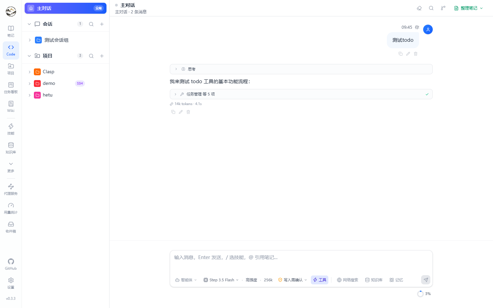
</p>

<h1 align="center">Hetu 河图</h1>

<p align="center">
  <strong>A local-first AI knowledge &amp; agent workspace.</strong><br>
  Notes, conversations and coding sessions on one local database.
</p>

<p align="center">
  <a href="https://github.com/wosledon/Hetu/releases/latest"></a>
  <a href="./LICENSE"></a>
  
  
  
</p>

<p align="center">
  <a href="https://wosledon.github.io/Hetu/en/">Website</a> ·
  <a href="https://wosledon.github.io/Hetu/en/guide/">Documentation</a> ·
  <a href="https://github.com/wosledon/Hetu/releases/latest">Download</a> ·
  <a href="./README.zh-CN.md">简体中文</a>
</p>

---

Hetu is a desktop app with a local backend: write Markdown notes, ask an agent to work through a problem, and let Code sessions edit a real repository. All of it reads and writes the same SQLite database (or PostgreSQL), so retrieval, the knowledge graph, Wiki and long-term memory grow from the same material. No account, no telemetry, no uploads — model calls only go to the providers you configure.

## Why Hetu

- **One knowledge base, not three tools.** Notes, conversations, code changes, memories and tasks live in one database. The retrieval index and the agent see the same context instead of a copy-pasted transcript.
- **An agent that can actually work.** Code sessions get an isolated worktree, a real PTY terminal, line-by-line diffs, checkpoint rollback, Git, and pull requests through `gh`/`glab`.
- **Local by default.** No account and no cloud copy. API keys are encrypted at rest, data stays in your user data directory, and network access is limited to the providers and MCP servers you enable.
- **Composable, not monolithic.** MCP servers, skills, agent presets, workflows and kanban tasks all plug into the same agent loop.

## Quick start

### 1. Install the desktop app (recommended)

Download from [GitHub Releases](https://github.com/wosledon/Hetu/releases/latest):

| Channel | Windows | Linux | Requires |
| --- | --- | --- | --- |
| `fat` | `Hetu_x.y.z_x64-setup.exe` / `Hetu_x.y.z_x64_en-US.msi` | `Hetu_x.y.z_amd64.AppImage` / `.deb` | Nothing extra — bundles the .NET 10 runtime |
| `slim` | `Hetu.Slim._x.y.z_x64-setup.exe` / `Hetu.Slim._x.y.z_x64_en-US.msi` | `Hetu.Slim._x.y.z_amd64.AppImage` / `.deb` | .NET 10 runtime installed on the system |

The channels update independently. Closing the window keeps Hetu in the tray with the backend and background jobs running; use **Quit Hetu** in the tray menu to exit.

### 2. Or run from source

Requires **.NET SDK 10+**, **Node.js 20+** and Git.

```bash
git clone https://github.com/wosledon/Hetu
cd Hetu

pwsh ./scripts/start.ps1     # Windows
./scripts/start.sh           # Linux / macOS
```

| Service | URL |
| --- | --- |
| Frontend | <http://localhost:5174> |
| API | <http://localhost:5000/api> |
| API reference (Scalar) | <http://localhost:5000/scalar/v1> |
| Health check | <http://localhost:5000/api/health> |

### 3. First-run setup

1. **Models → Add provider** — OpenAI-compatible or Anthropic, with base URL and API key.
2. **Settings → Default models** — pick per-scenario defaults (chat, coding, Wiki, graph, notes).
3. **Notes → Generate index** to make content searchable; **Code** to open a repository and start a session.

> Anthropic has no public embedding endpoint — choose an OpenAI-compatible provider for the `embedding` purpose. Vector dimensions (`Embedding:Dimensions`, default 1536) must match the model.

## What's inside

| Area | What you get | Guide |
| --- | --- | --- |
| **Notes** | WYSIWYG (Milkdown) + source (CodeMirror) views, selection AI actions, version history, share links, trash, Markdown export | [Notes](docs/guide/notes.html) |
| **Agent workspace** | Sessions and topics, SSE streaming, tool approvals, five permission modes, send queue, mid-run steering, distill to note | [Workspace](docs/guide/workspace.html) |
| **Code sessions** | Local or SSH projects, isolated worktrees, branch sync, files/changes/checkpoints/Git/PR/browser/terminal panels | [Code sessions](docs/guide/code-sessions.html) |
| **Knowledge** | Chunking and embeddings for notes/files/URLs, index coverage, semantic search playground, knowledge graph, project Wiki generation — Wiki pages are projected into the knowledge base and graph | [Knowledge base](docs/guide/knowledge.html) · [Graph & Wiki](docs/guide/graph-wiki.html) |
| **Memory** | Global/session/project scopes, recall scoring, memory graph, Dream consolidation (merge, decay, forget) | [Memories & Dream](docs/guide/memories.html) |
| **Automation** | Kanban tasks executed by agents, visual workflows, background and Cron jobs, inbox notifications | [Kanban & automation](docs/guide/organize.html) |
| **Extensibility** | Agent presets with tool allowlists, skills (`/skill-name`), built-in tool toggles and MCP servers | [Extensions & MCP](docs/guide/extensions.html) |
| **Models & cost** | Multiple providers, per-scenario defaults, OpenAI/Anthropic-compatible proxy, token and cost analytics, compression pipeline | [Models & usage](docs/guide/models.html) |

## Screenshots

<table>
  <tr>
    <td width="33%">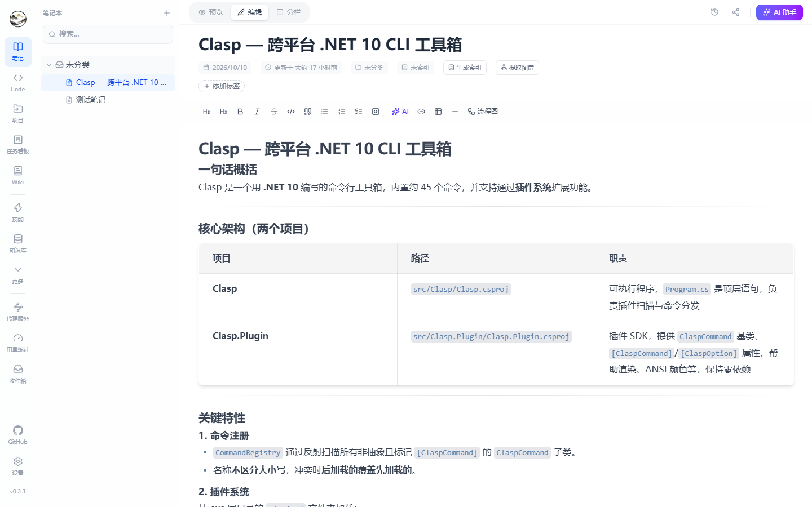<br><sub><b>Notes</b> — notebooks, tags and AI actions</sub></td>
    <td width="33%">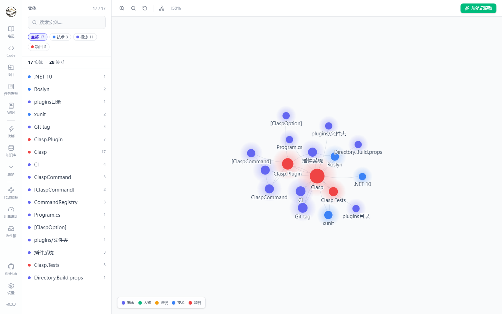<br><sub><b>Knowledge graph</b> — entities and relations</sub></td>
    <td width="33%">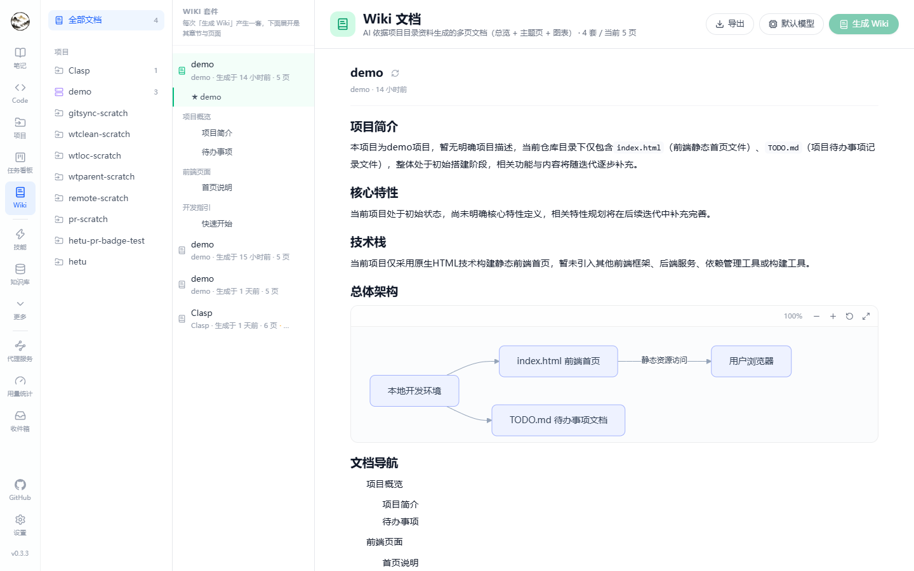<br><sub><b>Wiki</b> — generated project documentation</sub></td>
  </tr>
  <tr>
    <td>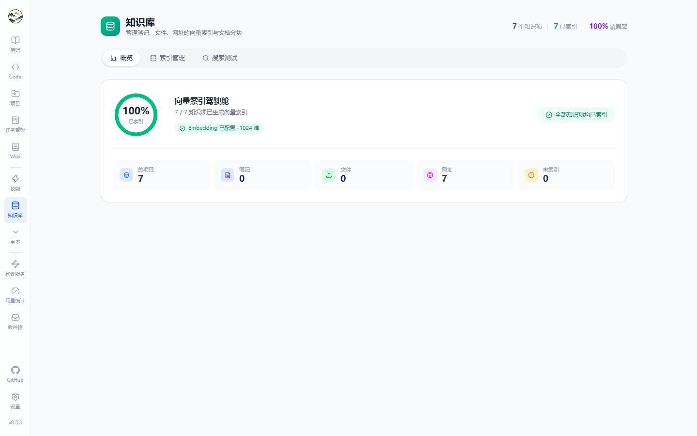<br><sub><b>Knowledge base</b> — index coverage and search</sub></td>
    <td>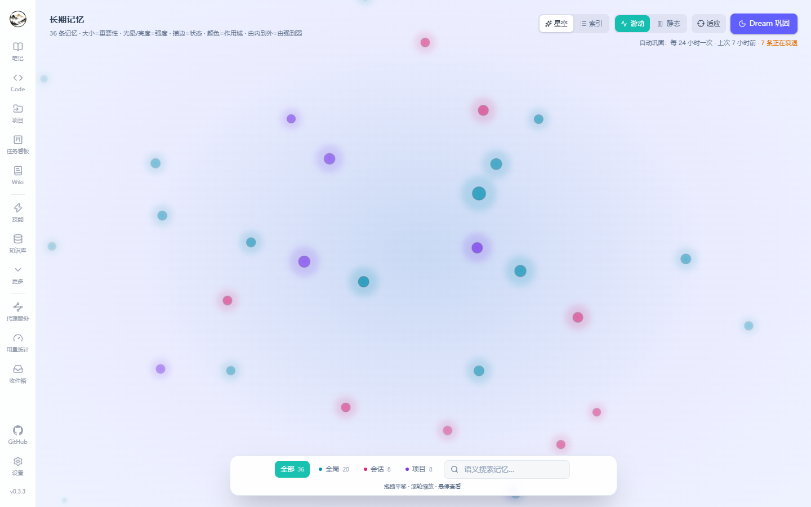<br><sub><b>Memories</b> — scopes and Dream</sub></td>
    <td>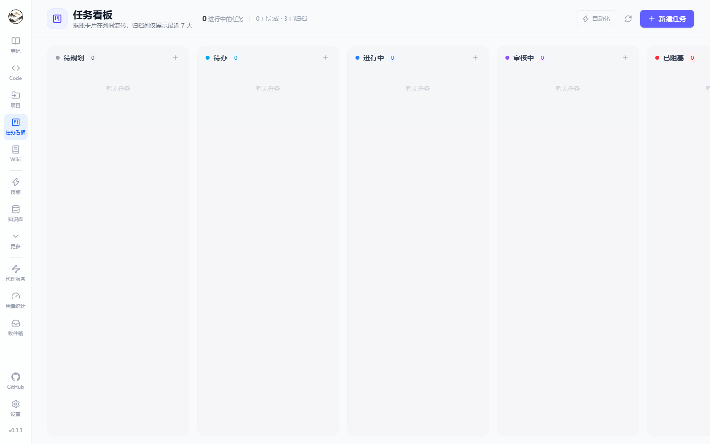<br><sub><b>Kanban</b> — tasks executed by agents</sub></td>
  </tr>
  <tr>
    <td>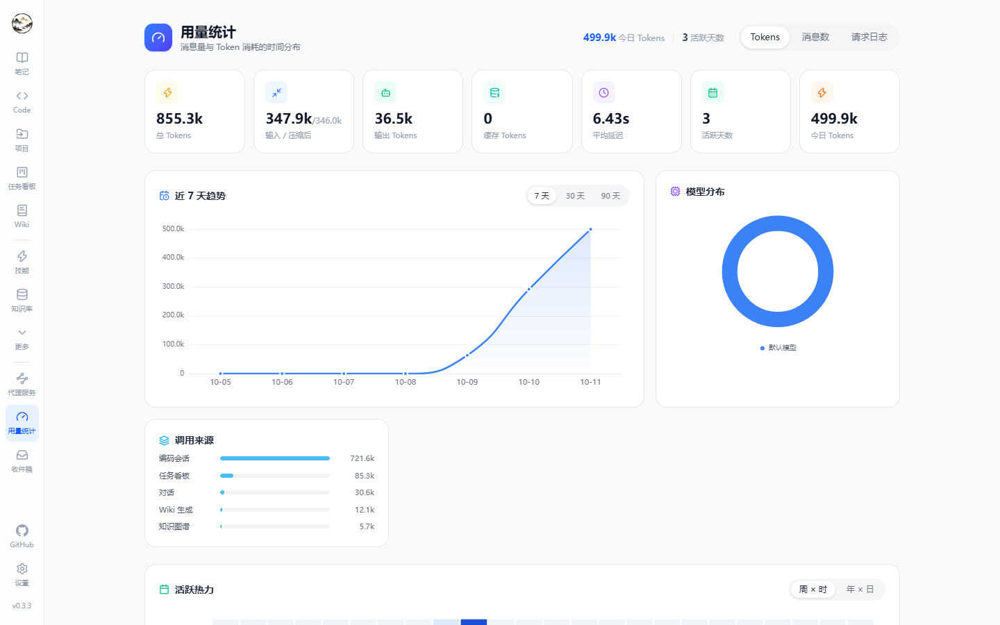<br><sub><b>Usage</b> — tokens, latency and cost</sub></td>
    <td>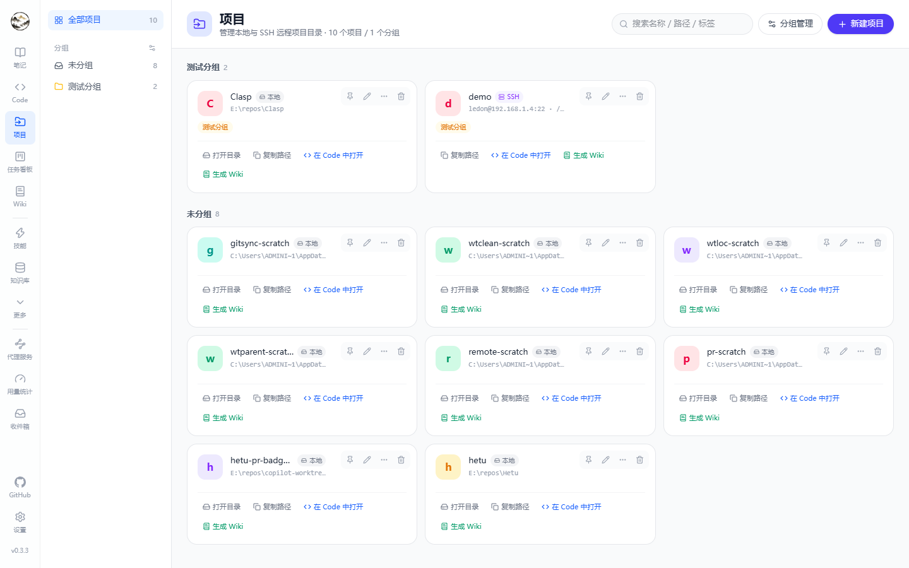<br><sub><b>Projects</b> — local and SSH repositories</sub></td>
    <td>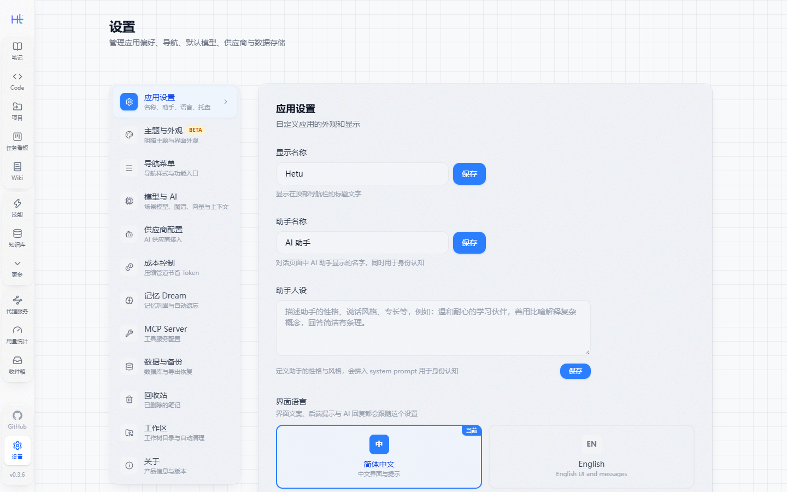<br><sub><b>Settings</b> — models, data, workspace</sub></td>
  </tr>
</table>

<details>
<summary><b>More screenshots</b> (theme and appearance, background tasks)</summary>
<br>
<table>
  <tr>
    <td width="50%">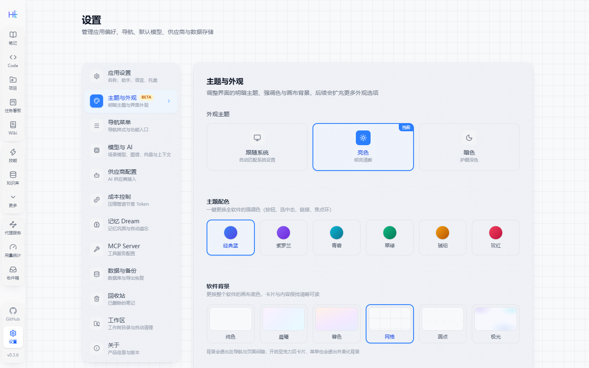<br><sub><b>Appearance</b> — accent palettes and theme</sub></td>
    <td width="50%">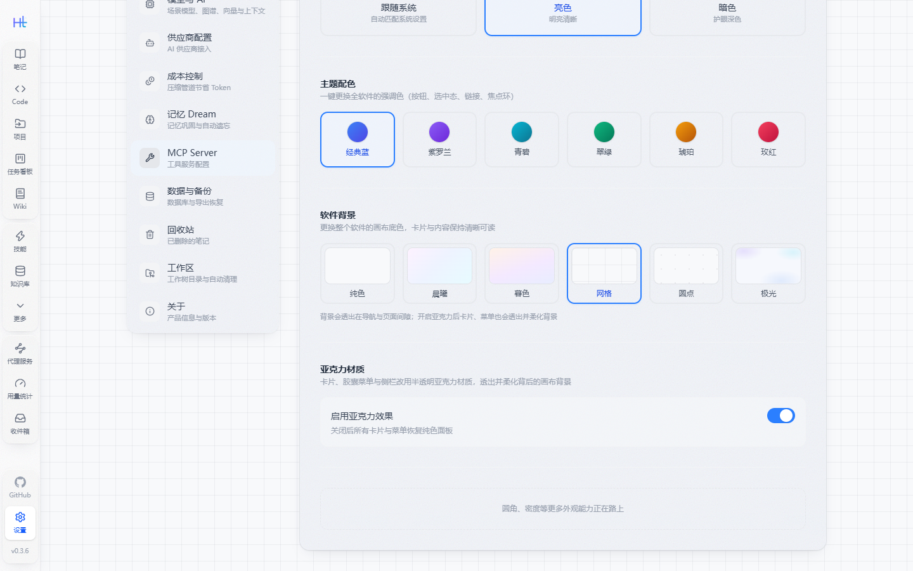<br><sub><b>Material</b> — acrylic canvas (Beta)</sub></td>
  </tr>
  <tr>
    <td>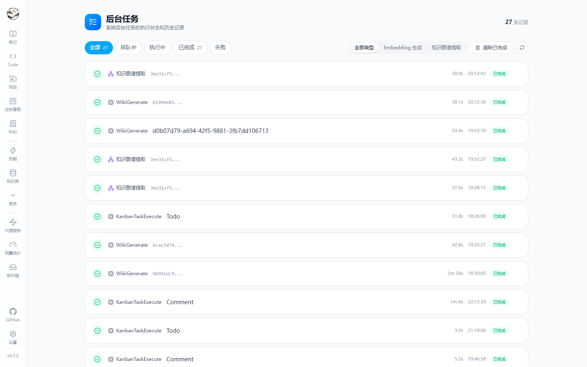<br><sub><b>Background tasks</b> — status, duration, failures</sub></td>
    <td><br><sub><b>Code session</b> — conversation and work panels</sub></td>
  </tr>
</table>
</details>

## Architecture

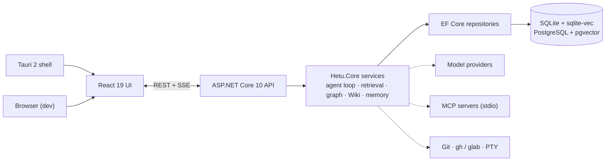

| Layer | Stack |
| --- | --- |
| Backend | ASP.NET Core 10 · EF Core 10 · Serilog · Scalar (OpenAPI) |
| Storage | SQLite + `sqlite-vec` (default) · PostgreSQL 16+ + `pgvector` |
| Frontend | React 19 · TypeScript 6 · Vite 8 · Tailwind CSS 4 · react-router 7 |
| State | Zustand (client) · TanStack Query (server) |
| Editors & visuals | Milkdown · CodeMirror · xterm.js · react-markdown + KaTeX + Mermaid · ECharts · XYFlow + dagre |
| AI | OpenAI-compatible & Anthropic protocols · embeddings · SSE · MCP (JSON-RPC 2.0) |
| Desktop | Tauri 2 (Rust shell + sidecar backend + updater) |
| i18n | i18next (简体中文 / English) |

## Development

```bash
# Backend: Release build, expected to finish with zero warnings
dotnet build src/Hetu.Api/Hetu.Api.csproj -c Release -v q

# Core tests (xUnit + NSubstitute)
dotnet test src/Hetu.Core.Tests/Hetu.Core.Tests.csproj

# Frontend: lint, type-check and production build
cd frontend
npx eslint .
npm run build
```

This project is **warning-intolerant**: no `#pragma warning disable`, `SuppressMessage`, `eslint-disable` or `@ts-ignore`. Fix the root cause. Layering, naming, SQLite quirks and commit conventions are documented in [`AGENTS.md`](./AGENTS.md).

<details>
<summary><b>Project layout and routes</b></summary>

```
Hetu/
├── src/
│   ├── Hetu.Api/                                 # API host, SSE streams, background workers
│   ├── Hetu.Core/                                # Entities, services, repository interfaces
│   ├── Hetu.Core.Tests/                          # xUnit + NSubstitute tests
│   ├── Hetu.Infrastructure/                      # EF Core, AI providers, MCP, sqlite-vec
│   ├── Hetu.Infrastructure.PostgresMigrations/   # PostgreSQL migrations and model snapshots
│   └── Hetu.Shared/                              # DTOs shared with the frontend
├── frontend/                                     # React + Vite app
├── shell/hetu-desktop/                           # Tauri 2 shell, tray, updater, NSIS hooks
├── scripts/                                      # start / desktop-dev / publish / release / smoke tests
├── docs/                                         # GitHub Pages site, PRD and screenshots
└── AGENTS.md                                     # Implementation conventions
```

Main routes (`frontend/src/App.tsx`): `/` notes · `/code` agent workspace · `/projects` · `/knowledge-base` · `/graph` · `/wiki` · `/memories` · `/kanban` · `/workflows` · `/tasks/background` · `/tasks/scheduled` · `/agents` · `/skills` · `/tools` · `/models` · `/proxy` · `/usage` · `/inbox` · `/tags` · `/trash` · `/settings` · `/share/:code`.

</details>

<details>
<summary><b>PostgreSQL and desktop packaging</b></summary>

```bash
# Switch the backend to PostgreSQL (pgvector required)
export DatabaseProvider=Postgresql
export ConnectionStrings__DefaultConnection="Host=localhost;Database=hetu;Username=postgres;Password=..."

# Apply migrations
dotnet ef database update \
  --project src/Hetu.Infrastructure.PostgresMigrations \
  --startup-project src/Hetu.Api
```

```bash
# Desktop development: dotnet + Vite + Tauri
pwsh ./scripts/desktop-dev.ps1

# Package a sidecar first, then build the installer
pwsh ./scripts/publish-backend.ps1 -Mode SelfContained -Rid win-x64
cd shell/hetu-desktop
npm run tauri:build:fat    # or tauri:build:slim for the slim channel
```

</details>

## Status and limitations

- **MCP:** `stdio` is fully wired; `sse` is configurable but not connected.
- **Note search:** uses `LIKE`; an FTS5 / `tsvector` upgrade is planned.
- **Embeddings:** Anthropic exposes no public embedding API — use an OpenAI-compatible provider.
- **Testing:** core logic has xUnit + NSubstitute coverage; UI verification is build + lint + real browser checks.

## Contributing

Issues and pull requests are welcome. Read [`AGENTS.md`](./AGENTS.md) before changing code; it covers layering, the warning policy and the verification checklist.

```
<type>(<scope>): <subject>

# type:  feat | fix | docs | style | refactor | perf | test | chore
# scope: api | ui | db | ai | work | desktop | config
```

## License

[Apache License 2.0](./LICENSE)
