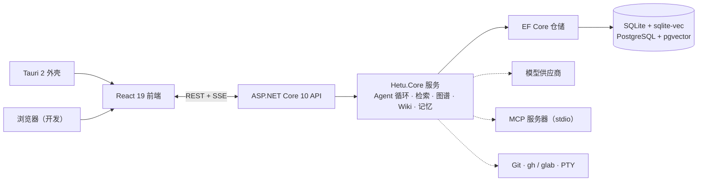

<p align="center">
  
</p>

<h1 align="center">Hetu 河图</h1>

<p align="center">
  <strong>本地优先的 AI 知识与 Agent 工作台。</strong><br>
  笔记、对话与编码会话，共用一份本地数据库。
</p>

<p align="center">
  <a href="https://github.com/wosledon/Hetu/releases/latest"></a>
  <a href="./LICENSE"></a>
  
  
  
</p>

<p align="center">
  <a href="https://wosledon.github.io/Hetu/">官网</a> ·
  <a href="https://wosledon.github.io/Hetu/guide/">文档</a> ·
  <a href="https://github.com/wosledon/Hetu/releases/latest">下载</a> ·
  <a href="./README.md">English</a>
</p>

---

Hetu（河图）是一个带本地后端的桌面应用：写 Markdown 笔记，让 Agent 把问题想清楚，再让 Code 会话直接修改真实仓库。三者读写同一份 SQLite（或 PostgreSQL）数据，检索索引、知识图谱、Wiki 与长期记忆都从同一批材料里生长出来。没有账号、没有遥测、不上传内容——模型请求只发往你自己配置的供应商。

## 为什么是 Hetu

- **一份知识底座，而不是三个割裂的工具。** 笔记、对话、代码改动、记忆与任务写进同一个数据库；检索索引和 Agent 看到的是同一份上下文，不用再把聊天记录复制来复制去。
- **真的能动手。** Code 会话拥有独立工作树、真实 PTY 终端、逐行 Diff、检查点回滚、Git 提交，以及通过 `gh`/`glab` 创建和操作 Pull Request。
- **默认留在本地。** 不需要账号，也没有云端副本。API Key 加密落库，数据保存在用户数据目录，网络访问只限于你明确启用的供应商与 MCP 服务器。
- **可组合，而不是一个大而全的封闭体。** MCP 服务器、技能、智能体预设、工作流与看板任务，都围绕同一个 Agent 循环工作。

## 快速开始

### 1. 安装桌面版（推荐）

从 [GitHub Releases](https://github.com/wosledon/Hetu/releases/latest) 下载：

| 渠道 | Windows | Linux | 依赖 |
| --- | --- | --- | --- |
| `fat` | `Hetu_x.y.z_x64-setup.exe` / `Hetu_x.y.z_x64_en-US.msi` | `Hetu_x.y.z_amd64.AppImage` / `.deb` | 无需额外安装，自带 .NET 10 运行时 |
| `slim` | `Hetu.Slim._x.y.z_x64-setup.exe` / `Hetu.Slim._x.y.z_x64_en-US.msi` | `Hetu.Slim._x.y.z_amd64.AppImage` / `.deb` | 系统需已安装 .NET 10 运行时 |

两个渠道独立更新，互不覆盖。关闭主窗口后 Hetu 会留在托盘，后端与后台任务继续运行；要真正退出请用托盘菜单里的 **退出 Hetu**。

### 2. 或者从源码运行

需要 **.NET SDK 10+**、**Node.js 20+** 与 Git。

```bash
git clone https://github.com/wosledon/Hetu
cd Hetu

pwsh ./scripts/start.ps1     # Windows
./scripts/start.sh           # Linux / macOS
```

| 服务 | 地址 |
| --- | --- |
| 前端 | <http://localhost:5174> |
| 接口 | <http://localhost:5000/api> |
| 接口文档（Scalar） | <http://localhost:5000/scalar/v1> |
| 健康检查 | <http://localhost:5000/api/health> |

### 3. 首次配置

1. **大模型 → 新增供应商**：选择 OpenAI 兼容或 Anthropic，填入 Base URL 与 API Key。
2. **设置 → 默认模型**：按场景指定默认模型（对话、编码、Wiki、图谱、笔记）。
3. **笔记 → 生成索引**，让内容进入知识库；打开 **Code** 选择仓库即可开始会话。

> Anthropic 没有公开的 Embedding 接口，`embedding` 用途请选 OpenAI 兼容供应商。向量维度（`Embedding:Dimensions`，默认 1536）必须与模型一致。

## 功能一览

| 模块 | 你能得到什么 | 文档 |
| --- | --- | --- |
| **笔记** | Milkdown 所见即所得 + CodeMirror 源码视图、选区 AI 动作、历史版本、分享链接、回收站、Markdown 导出 | [笔记](docs/guide/notes.html) |
| **Agent 工作台** | 会话与话题、SSE 流式输出、工具审批、五档权限模式、发送队列、运行中引导、整理成笔记 | [Agent 工作台](docs/guide/workspace.html) |
| **Code 会话** | 本地或 SSH 项目、独立工作树、分支同步、文件/更改/检查点/Git/PR/浏览器/终端七个面板 | [Code 会话](docs/guide/code-sessions.html) |
| **知识** | 笔记/文件/网址的分块与向量化、索引覆盖率、语义搜索实验台、知识图谱、按项目生成 Wiki；Wiki 页面会自动进入知识库与图谱 | [知识库](docs/guide/knowledge.html) · [图谱与 Wiki](docs/guide/graph-wiki.html) |
| **记忆** | 全局/会话/项目作用域、召回打分、记忆图、Dream 巩固（合并、衰减、遗忘） | [记忆与 Dream](docs/guide/memories.html) |
| **自动化** | 由 Agent 执行的任务看板、可视化工作流、后台与 Cron 定时任务、收件箱通知 | [看板与自动化](docs/guide/organize.html) |
| **扩展** | 带工具白名单的智能体预设、技能（`/技能名`）、内置工具开关、MCP 服务器 | [扩展与集成](docs/guide/extensions.html) |
| **模型与成本** | 多供应商、按场景默认模型、OpenAI/Anthropic 兼容代理、Token 与成本统计、压缩管道 | [模型与用量](docs/guide/models.html) |

## 界面

<table>
  <tr>
    <td width="33%"><br><sub><b>笔记</b> — 笔记本、标签与 AI 动作</sub></td>
    <td width="33%"><br><sub><b>知识图谱</b> — 实体与关系</sub></td>
    <td width="33%"><br><sub><b>Wiki</b> — 生成项目文档</sub></td>
  </tr>
  <tr>
    <td><br><sub><b>知识库</b> — 索引覆盖率与检索</sub></td>
    <td><br><sub><b>记忆</b> — 作用域与 Dream</sub></td>
    <td><br><sub><b>任务看板</b> — Agent 执行任务</sub></td>
  </tr>
  <tr>
    <td><br><sub><b>用量</b> — Token、延迟与成本</sub></td>
    <td><br><sub><b>项目</b> — 本地与 SSH 仓库</sub></td>
    <td><br><sub><b>设置</b> — 模型、数据与工作区</sub></td>
  </tr>
</table>

<details>
<summary><b>更多截图</b>（主题外观、后台任务）</summary>
<br>
<table>
  <tr>
    <td width="50%"><br><sub><b>外观</b> — 主题配色与强调色</sub></td>
    <td width="50%"><br><sub><b>材质</b> — 亚克力画布（Beta）</sub></td>
  </tr>
  <tr>
    <td><br><sub><b>后台任务</b> — 状态、耗时与失败原因</sub></td>
    <td><br><sub><b>Code 会话</b> — 对话与工作面板</sub></td>
  </tr>
</table>
</details>

## 架构



| 层 | 技术 |
| --- | --- |
| 后端 | ASP.NET Core 10 · EF Core 10 · Serilog · Scalar（OpenAPI） |
| 存储 | SQLite + `sqlite-vec`（默认）· PostgreSQL 16+ + `pgvector` |
| 前端 | React 19 · TypeScript 6 · Vite 8 · Tailwind CSS 4 · react-router 7 |
| 状态 | Zustand（客户端）· TanStack Query（服务端） |
| 编辑与可视化 | Milkdown · CodeMirror · xterm.js · react-markdown + KaTeX + Mermaid · ECharts · XYFlow + dagre |
| AI | OpenAI 兼容与 Anthropic 协议 · Embedding · SSE · MCP（JSON-RPC 2.0） |
| 桌面 | Tauri 2（Rust 外壳 + sidecar 后端 + 自动更新） |
| 国际化 | i18next（简体中文 / English） |

## 开发

```bash
# 后端：Release 构建，期望 0 告警
dotnet build src/Hetu.Api/Hetu.Api.csproj -c Release -v q

# 核心逻辑测试（xUnit + NSubstitute）
dotnet test src/Hetu.Core.Tests/Hetu.Core.Tests.csproj

# 前端：Lint、类型检查与生产构建
cd frontend
npx eslint .
npm run build
```

本项目**对告警零容忍**：不允许 `#pragma warning disable`、`SuppressMessage`、`eslint-disable` 或 `@ts-ignore`，只能修根因。分层、命名、SQLite 限制与提交格式见 [`AGENTS.md`](./AGENTS.md)。

<details>
<summary><b>目录结构与路由</b></summary>

```
Hetu/
├── src/
│   ├── Hetu.Api/                                 # API 宿主、SSE 流、后台 Worker
│   ├── Hetu.Core/                                # 实体、领域服务、仓储接口
│   ├── Hetu.Core.Tests/                          # xUnit + NSubstitute 测试
│   ├── Hetu.Infrastructure/                      # EF Core、AI Provider、MCP、sqlite-vec
│   ├── Hetu.Infrastructure.PostgresMigrations/   # PostgreSQL 迁移与模型快照
│   └── Hetu.Shared/                              # 前后端共享 DTO
├── frontend/                                     # React + Vite 前端
├── shell/hetu-desktop/                           # Tauri 2 外壳、托盘、更新器、NSIS 钩子
├── scripts/                                      # start / desktop-dev / publish / release / 冒烟测试
├── docs/                                         # GitHub Pages 官网、PRD 与截图
└── AGENTS.md                                     # 实现约定
```

主要路由（`frontend/src/App.tsx`）：`/` 笔记 · `/code` Agent 工作台 · `/projects` · `/knowledge-base` · `/graph` · `/wiki` · `/memories` · `/kanban` · `/workflows` · `/tasks/background` · `/tasks/scheduled` · `/agents` · `/skills` · `/tools` · `/models` · `/proxy` · `/usage` · `/inbox` · `/apps` · `/tags` · `/trash` · `/settings` · `/share/:code`。

</details>

<details>
<summary><b>PostgreSQL 与桌面打包</b></summary>

```bash
# 切换到 PostgreSQL（需要 pgvector）
export DatabaseProvider=Postgresql
export ConnectionStrings__DefaultConnection="Host=localhost;Database=hetu;Username=postgres;Password=..."

# 应用迁移
dotnet ef database update \
  --project src/Hetu.Infrastructure.PostgresMigrations \
  --startup-project src/Hetu.Api
```

```bash
# 桌面开发模式：并行启动 dotnet + Vite + Tauri
pwsh ./scripts/desktop-dev.ps1

# 先发布 sidecar，再构建安装包
pwsh ./scripts/publish-backend.ps1 -Mode SelfContained -Rid win-x64
cd shell/hetu-desktop
npm run tauri:build:fat    # slim 渠道用 tauri:build:slim
```

</details>

## 当前限制

- **MCP**：`stdio` 已完整支持；`sse` 可配置，但尚未接通。
- **笔记搜索**：目前使用 `LIKE`，计划升级到 FTS5 / `tsvector`。
- **Embedding**：Anthropic 没有公开的 Embedding 接口，请使用 OpenAI 兼容供应商。
- **测试**：核心逻辑已有 xUnit + NSubstitute 覆盖；界面通过构建、Lint 与真实浏览器验证。

## 参与贡献

欢迎提交 Issue 与 PR。改代码前请先读 [`AGENTS.md`](./AGENTS.md)，其中写明了分层约定、告警策略与验证清单。

```
<type>(<scope>): <subject>

# type:  feat | fix | docs | style | refactor | perf | test | chore
# scope: api | ui | db | ai | work | desktop | config
```

## 许可证

[Apache License 2.0](./LICENSE)
